<a href="https://muzaffarov.uz/">
  
</a>

<p align="center">
  <a href="https://muzaffarov.uz/"></a>
  <a href="https://t.me/unnohwn"></a>
  <a href="https://www.linkedin.com/in/muzaffarov/"></a>
  <a href="mailto:muzaffarovrajab25@gmail.com"></a>
  <a href="https://muzaffarov.uz/Rajab-Muzaffarov-CV.pdf"></a>
</p>

<br>


```ts
const rajab = {
  name:     "Rajab Muzaffarov",
  role:     "Full-stack developer",
  base:     "Tashkent, Uzbekistan",
  stack:    ["TypeScript", "React", "Next.js", "Node.js", "PostgreSQL"],
  builds:   "platforms that run real business workflows",
  learning: ["AI agents", "Cloudflare at the edge"],
  motto:    "ship it loud \\m/",
} as const;
```


| | Project | What it does |
|:-:|---|---|
| 🍊 | **Frutera** <br><sub>Cresta Systems</sub> | Export-logistics ERP that replaced the spreadsheets and group chats of an agricultural exporter. Pulls from Telegram groups, the customs portal, Google Sheets and WhatsApp; Claude extracts shipments, declarations and payments; a nightly pass reconciles client ledgers. **~105k lines · 150 API endpoints · 38 tables · 6 Docker services.** |
| 🤖 | **AI Avtojavob / Aylo** | AI sales automation across Instagram, Telegram, Facebook and WhatsApp. Turns keyword-matching Instagram comments into AI-written DM replies, with custom prompts, admin consoles and self-serve onboarding. |
| 🧪 | **Sifat Nazorat** | Quality-control platform for lab testing and product certification, with QR-code verification pages for every certificate. Next.js, MongoDB, Supabase Auth. |
| 🏛️ | **[T-SX](https://t-sx.uz/)** <br><sub>Toshkent Sinov Xizmati</sub> | Official website with a news CMS, photo gallery and admin panel. |
| ⚡ | **[Cresta](https://cresta.uz/)** | Corporate website, Telegram bot and CRM for a new development company. |
| 🧵 | **Fimtext** | Landing page for a textile testing and quality-control lab. |

<p align="right"><a href="https://muzaffarov.uz/#work"><b>Full case studies → muzaffarov.uz</b></a></p>


<p align="center">
  
</p>

<p align="center">
  <sub>also: shadcn/ui · Zustand · Redux Toolkit · TanStack Query · React Hook Form · Zod · JWT · n8n · Telegram Bot API · MTProto · Cloudflare R2</sub>
</p>


```diff
+ shipping   Frutera: Telegram Mini App + Android app for field entry
+ building   a cross-platform IT startup
+ learning   AI agents and Cloudflare at the edge
- sleeping   rarely
```

<br>

<a href="https://muzaffarov.uz/">
  
</a>
